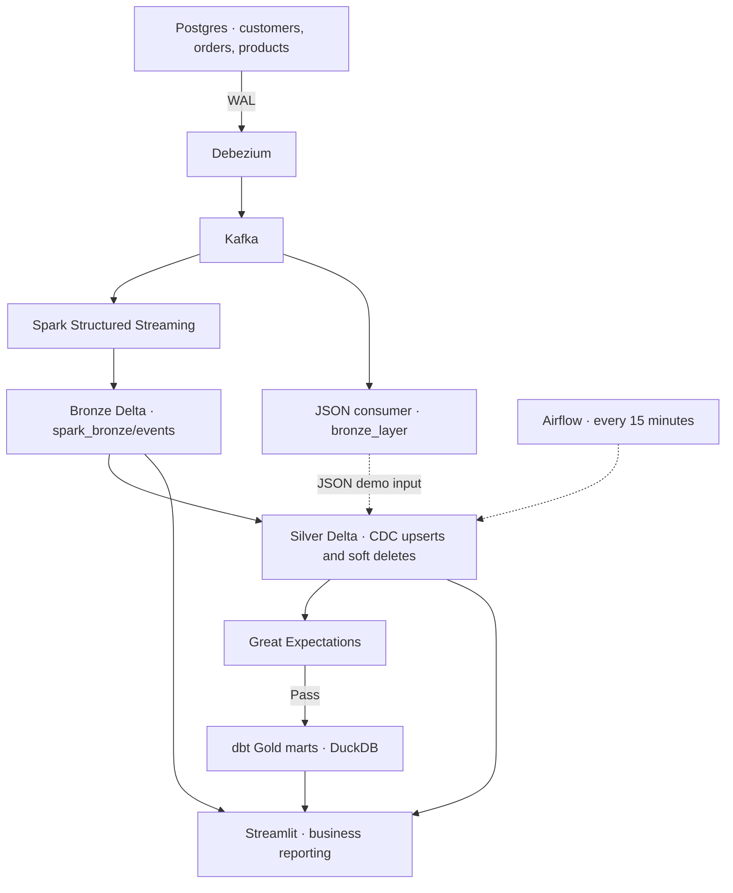

# ⚡ CDC Lakehouse Pipeline

> **Postgres → Debezium → Kafka → Spark → Delta Lake → Great Expectations → dbt → Streamlit**
>
> A local Change Data Capture (CDC) pipeline demonstrating real-time ingestion,
> open table format storage (Delta Lake), schema evolution, time travel, data contracts,
> and automated quality gates — all running locally via Docker.

---

## Architecture



Spark continuously ingests Kafka events into Bronze Delta. Airflow schedules
the Silver merge, quality checks, and dbt work. Streamlit shows the selected
Bronze feed, current and historical Silver snapshots, and Gold marts.

---

## Quick Start

### Prerequisites
- Docker Desktop
- Python 3.10+

### 1. Install Python dependencies

```bash
pip install -r requirements.txt
```

### Repeatable ecommerce demo

From PowerShell, run the complete local demo with one command:

```powershell
.\run_demo.ps1
```

The runner starts Docker services, registers the Debezium connector if needed,
starts the JSON Bronze consumer, creates ecommerce changes, waits for all six
expected events, then runs Silver, data quality, dbt, and dbt test stages.
Repeating the demo creates a new set of sample rows.

Useful options:

```powershell
# Capture CDC events but skip downstream processing
.\run_demo.ps1 -SkipPipeline

# Keep the consumer logs for troubleshooting
.\run_demo.ps1 -KeepConsumerLog

# Use an already running inventory stack
.\run_demo.ps1 -ReuseServices
```

After a successful run, launch the dashboard:

```powershell
$env:CDC_BRONZE_SOURCE = "json"
.\.venv\Scripts\python.exe -m streamlit run dashboard/app.py
```

### Spark Structured Streaming path

Milestone 5 adds a real streaming ingestion path alongside the JSON consumer.
Start it with the core Kafka stack:

```powershell
docker compose -f docker-compose.yml -f docker-compose.spark.yml up -d
```

Spark reads the Debezium topics through Kafka's internal listener and writes an
append-only Delta Bronze table to `spark_bronze/events`, with a checkpoint at
`checkpoints/kafka_to_delta`. The full Debezium event is retained in
`debezium_event`, while common CDC fields are extracted for filtering.

Silver and the dashboard use the same Bronze source selection. The default
`CDC_BRONZE_SOURCE=auto` selects the Spark Delta table once it exists and uses
JSON before then. Set `CDC_BRONZE_SOURCE=spark` or `CDC_BRONZE_SOURCE=json`
to select a specific source. The JSON demo selects JSON for its pipeline run.

Run a bounded catch-up for a demo or recovery test:

```powershell
docker compose -f docker-compose.yml -f docker-compose.spark.yml run --rm spark-streaming /opt/spark/bin/spark-submit --master local[*] --packages io.delta:delta-spark_2.12:3.2.0,org.apache.spark:spark-sql-kafka-0-10_2.12:3.5.3 /opt/project/streaming/spark_stream.py --once
```

The default service runs continuously. Stop only the Spark service with:

```powershell
docker compose -f docker-compose.yml -f docker-compose.spark.yml stop spark-streaming
```

### Airflow orchestration

Milestone 4 adds a separate local Airflow stack. Start the CDC services first,
then build and start Airflow from a second PowerShell terminal:

```powershell
docker compose -f docker-compose.airflow.yml up -d --build
```

Open http://localhost:8080 and sign in with `admin` / `admin`. The DAG
`cdc_lakehouse_pipeline` runs the existing Silver, Great Expectations, dbt,
and schema-test stages in order. It is mounted from
`pipeline/airflow_dag.py` and is scheduled every 15 minutes.

Trigger it immediately without opening the UI:

```powershell
docker exec cdc-airflow airflow dags unpause cdc_lakehouse_pipeline
docker exec cdc-airflow airflow dags trigger cdc_lakehouse_pipeline
docker exec cdc-airflow airflow dags list-runs -d cdc_lakehouse_pipeline
```

View Airflow logs or stop the local orchestration stack:

```powershell
docker logs -f cdc-airflow
docker compose -f docker-compose.airflow.yml down
```

### Final validation and operations

Run the regression tests for CDC event transformation, delete handling,
deduplication, and Spark Bronze compatibility:

```powershell
.\.venv\Scripts\python.exe -m unittest discover -s tests -v
```

Check the live platform before a demo or scheduled run:

```powershell
.\ops\health_check.ps1
```

The health check verifies Postgres, Kafka, the Debezium connector, Spark
streaming, Spark Bronze Delta, Silver Delta, and Airflow when it is running.

### 2. Start Docker services

```bash
docker-compose up -d
```

Services started:
| Service | URL |
|---|---|
| Postgres | `localhost:5432` |
| Kafka | `localhost:9093` (external) |
| Debezium Connect | `http://localhost:8083` |
| Kafdrop (Kafka UI) | `http://localhost:9000` |

### 3. Register the Debezium connector

Wait ~15 seconds for services to fully start, then:

```bash
curl -X POST http://localhost:8083/connectors \
  -H "Content-Type: application/json" \
  -d @register-postgres.json
```

Verify it's running:
```bash
curl http://localhost:8083/connectors/inventory-connector/status
```

### 4. Run the Bronze consumer

```bash
python consumer.py
```

This listens on Kafka and writes CDC events to `bronze_layer/`. The consumer
retries Kafka startup, writes each event atomically, and includes the Kafka
partition and offset in the filename so retries cannot overwrite a different
event.

Useful options:

```powershell
# Drain available Kafka messages and exit
python consumer.py --batch --timeout 5000

# Use a separate consumer group and output location for a test run
python consumer.py --group-id bronze-test --output-dir bronze_test
```

### 5. Trigger some changes

Open a new terminal and run these SQL commands to generate CDC events:

```bash
# Insert a customer
docker exec -it postgres psql -U postgres -d inventory -c \
  "INSERT INTO inventory.customers (first_name, last_name, email) VALUES ('Alice', 'Demo', 'alice@demo.com');"

# Update a customer
docker exec -it postgres psql -U postgres -d inventory -c \
  "UPDATE inventory.customers SET first_name='UpdatedAlice' WHERE email='alice@demo.com';"

# Insert a product
docker exec -it postgres psql -U postgres -d inventory -c \
  "INSERT INTO inventory.products (name, description, weight) VALUES ('Gadget', 'Demo product', 1.5);"

# Delete a customer
docker exec -it postgres psql -U postgres -d inventory -c \
  "DELETE FROM inventory.customers WHERE email='alice@demo.com';"
```

### 6. Run the full pipeline

```bash
python pipeline/run_pipeline.py
```

This runs all stages in order:
1. ✅ Silver Processor (Delta Lake MERGE)
2. ✅ Data Quality Gate (Great Expectations)
3. ✅ dbt Staging models
4. ✅ dbt Mart models
5. ✅ dbt Schema tests

Or run stages individually:

```bash
# Silver layer only
python silver_processor.py

# Data quality only
python data_quality/run_checks.py

# dbt only
cd dbt_project && dbt run --profiles-dir . --project-dir .
```

### 7. Launch the dashboard

```bash
streamlit run dashboard/app.py
```

Open http://localhost:8501

---

## Key Concepts Demonstrated

### CDC (Change Data Capture)
Debezium reads Postgres WAL (Write-Ahead Log) and produces a Kafka message for every INSERT, UPDATE, and DELETE — without any application changes needed.

### Replay and Late Events
Silver deduplicates each batch by primary key, then merges only events newer
than the stored row. It compares the Debezium envelope timestamp and uses
Kafka partition and offset to break ties. Replaying the same event leaves
Silver unchanged, including when a delete has already been applied.

### Schema Evolution
Silver enables additive schema evolution on MERGE for new columns in CDC
events. Existing dbt models continue to select their declared output columns.

### Time Travel
Query Silver tables at any historical version:

```python
from deltalake import DeltaTable

# By version number
dt = DeltaTable("silver/customers", version=0)
df = dt.to_pandas()

# By timestamp
dt = DeltaTable("silver/customers")
dt.load_as_version("2026-10-25T10:00:00Z")
df = dt.to_pandas()
```

### Data Contracts (dbt schema.yml)
`dbt_project/models/schema.yml` defines column-level contracts:
- `unique` tests
- `not_null` tests
- `accepted_values` tests
- `relationships` (FK integrity) tests

`dbt test` enforces these and fails the pipeline on violations.

### Quality Gate
`data_quality/run_checks.py` exits with code `1` on violations. The pipeline runner checks this exit code and halts before dbt runs.

---

## Project Structure

```
Project/
├── docker-compose.yml          # Zookeeper + Kafka + Postgres + Debezium + Kafdrop
├── register-postgres.json      # Debezium connector config
├── consumer.py                 # Kafka → Bronze Layer (JSON)
├── silver_processor.py         # Bronze → Silver (Delta Lake MERGE)
├── requirements.txt            # All Python dependencies
│
├── bronze_layer/               # Raw CDC events (JSON)
│   ├── customers/
│   ├── orders/
│   └── products/
│
├── silver/                     # Delta Lake tables (Parquet + _delta_log/)
│   ├── customers/
│   ├── orders/
│   └── products/
│
├── dbt_project/                # dbt transformation project
│   ├── dbt_project.yml
│   ├── profiles.yml            # DuckDB adapter
│   └── models/
│       ├── staging/            # Clean typed staging views
│       ├── marts/              # Business aggregation tables
│       └── schema.yml          # Data contracts
│
├── data_quality/               # Great Expectations
│   ├── gx_setup.py             # Bootstrap GX context
│   ├── run_checks.py           # Run checks + pipeline gate
│   └── runtime_results/        # Local JSON reports read by the dashboard
│
├── pipeline/
│   ├── run_pipeline.py         # Master orchestrator
│   └── airflow_dag.py          # Equivalent Airflow DAG
│
├── dashboard/
│   ├── app.py                  # Streamlit dashboard (7 pages)
│   └── requirements.txt
│
└── Queries/
    └── try.md                  # SQL test queries
```

---

## Troubleshooting

**Debezium connector not starting:**
```bash
# Check connect logs
docker logs connect
# Verify postgres WAL level
docker exec -it postgres psql -U postgres -c "SHOW wal_level;"
# Should be 'logical'
```

**Silver table merge failing:**
```bash
# Check if Delta table exists
python -c "from deltalake import DeltaTable; print(DeltaTable('silver/customers').version())"
```

**dbt can't find Silver parquet files:**
```bash
# Ensure silver/ tables have been created first
ls silver/customers/
# Should see *.parquet files and _delta_log/
```

**Dashboard shows no data:**
```bash
# Run the full pipeline first
python pipeline/run_pipeline.py
# Then launch dashboard
streamlit run dashboard/app.py
```
